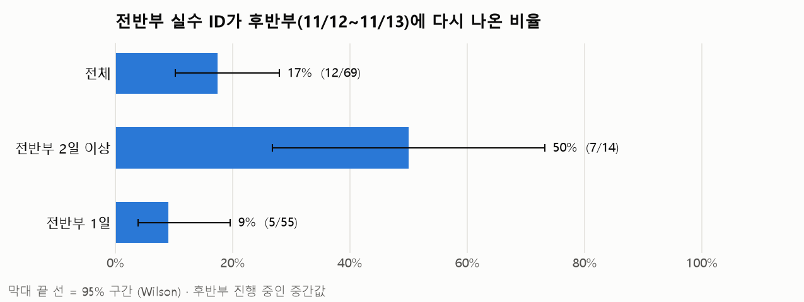
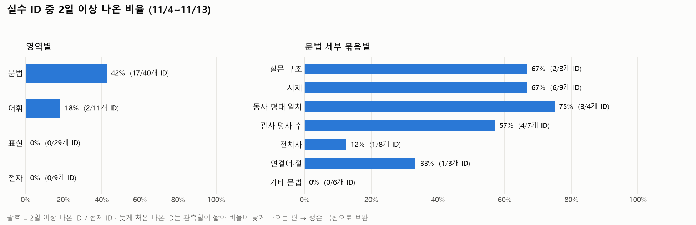
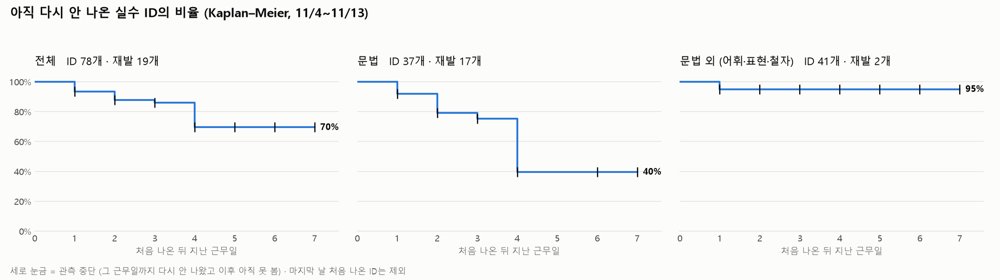

# A 분석 메모: 실수는 다시 나오는가 (7일차, 11/13)

> 실행: `python -m analysis.prep` → `python -m analysis.mistake_repeat`
> 데이터: 11/4~11/13 근무일 8일, 유효한 실수 기록 138건, 실수 ID 89개 (사람이 붙인 `mistake_id`)
> **중간값이다.** 후반부(11/12~11/18) 5근무일 중 2일만 들어왔다. 9일차(11/17)에 같은 코드로 다시 돌려 최종값을 낸다.

## 1. 전반부 실수가 후반부에 다시 나왔나 (핵심 지표)

분모 = 6일차에 고정한 전반부 실수 ID 69개 (`first_half_ids.csv`).

| 묶음 | 다시 나옴 | 비율 | 95% 구간 |
|---|---|---|---|
| 전체 | 12 / 69 | 17% | 10~28% |
| 전반부에 **2일 이상** 나온 ID | 7 / 14 | **50%** | 27~73% |
| 전반부에 1일만 나온 ID | 5 / 55 | 9% | 4~20% |

- **이미 반복되던 실수는 계속 나온다.** 2일 이상 ID와 1일 ID의 구간이 겹치지 않는다 (27~73% vs 4~20%). 표본이 작아도 이 차이는 우연으로 보기 어렵다.
- 다시 나온 7개 "고질 실수": `question_word_order`, `question_do_support`, `be_verb_missing`, `present_for_habit`, `article_missing`, `plural_noun`, `cause_connector`. 모두 문법이다.
- 후반부에 나온 ID 32개 중 20개는 전반부에 없던 새 ID다. 실수의 대부분은 아직 "처음 보는 실수"다.

## 2. 어떤 유형이 잘 반복되나

11/4~11/13 전체에서 2일 이상 나온 ID의 비율.

| 영역 | 2일 이상 / ID | 비율 |
|---|---|---|
| 문법 | 17 / 40 | **42%** |
| 어휘 | 2 / 11 | 18% |
| 표현 | 0 / 29 | 0% |
| 철자 | 0 / 9 | 0% |

문법 안에서는 질문 구조 2/3, 시제 6/9, 동사 형태·일치 3/4, 관사·명사 수 4/7로 높고, 전치사 1/8, 기타 문법 0/6으로 낮다.

**해석할 때 주의: ID를 나눈 굵기가 다르다.** 문법 ID는 규칙 단위(예: 질문 어순 전체가 ID 1개)라 어느 대화에서나 다시 걸릴 기회가 많다. 표현·철자 ID는 표현·단어 하나가 ID 1개라(예: `work_from_home`) 같은 표현을 다시 쓸 일이 없으면 재발할 수 없다. 그래서 "문법 실수가 더 고질적"이라기보다 **"규칙 단위로 묶이는 실수가 반복된다"**가 정확한 표현이다. 전치사가 낮은 것도 전치사 ID가 표현 단위(`at_home`, `preposition_on_trip`)로 붙어 있기 때문일 수 있다.

## 3. 다시 나오기까지 며칠 걸리나 (Kaplan–Meier)

처음 나온 근무일부터 다음에 다시 나온 근무일까지. 다시 안 나온 ID는 마지막 근무일(11/13)에서 관측 중단으로 처리했다. 11/13에 처음 나온 ID는 지켜본 날이 없어 뺐다.

| | ID | 재발 | 4근무일 뒤 아직 안 나온 비율 | 7근무일 뒤 |
|---|---|---|---|---|
| 전체 | 78 | 19 | 70% | 70% |
| 문법 | 37 | 17 | **40%** | 40% |
| 문법 외 | 41 | 2 | 95% | 95% |

- **문법 실수는 4근무일 안에 절반 이상(60%)이 다시 나온다.** 문법 외 실수는 거의 다시 안 나온다 (위 굵기 차이 주의).
- **4근무일 간격에서 크게 떨어진다.** 이 간격의 재발 9건 중 6건이 **같은 대화 스타일이 다시 나온 날**이었다 (11/5→11/11 목표 역할극 5건, 11/6→11/12 AI 이야기 1건). 스타일이 1주일 주기로 돌아 4근무일 뒤에 같은 상황이 오면서 같은 문장 구조를 다시 쓴 것으로 보인다. → **재발은 "아직 못 배웠다"뿐 아니라 "같은 상황을 다시 만났다"에도 달려 있다.** (가설, 표본 작음)
- 1근무일 간격 재발 5건은 모두 11/4→11/5다. 11/4는 채점 모델이 달랐을 가능성이 있어(`baseline.md`) 9일차에 11/4를 뺀 곡선도 함께 본다.

## 한계

- **기회를 세지 못한다.** 질문을 하지 않은 날에는 질문 어순 실수가 나올 수 없다. "다시 안 나옴"이 "고쳤다"인지 "쓸 일이 없었다"인지 구분하지 못한다. 숨은 연습 대상 성공 기록(`practice.csv`, 지금까지 3/21)이 유일한 "맞게 쓴" 증거다.
- **ID 굵기가 영역마다 다르다** (2절). 영역 비교는 참고용.
- 실수 ID는 한 사람이 붙였다. 9일차 AI 판정 30건 검수 때 ID 판단도 같이 다시 본다.
- 후반부 2일치 중간값. 날마다 대화 스타일이 하나라 날짜 효과와 스타일 효과가 섞여 있다.

## 9일차에 할 것

- 후반부 5일치로 1~3절 다시 계산 (같은 코드, `first_half_ids.csv` 분모 그대로)
- 11/4를 뺀 생존 곡선 (채점 모델 차이 점검)
- 고질 실수 7개가 후반부 마지막까지 계속 나오는지 → 리포트 "앞으로 연습할 것" 근거
