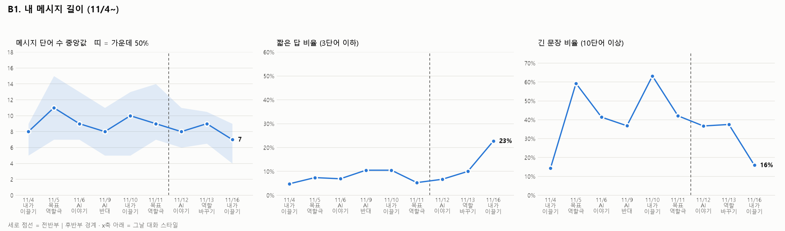
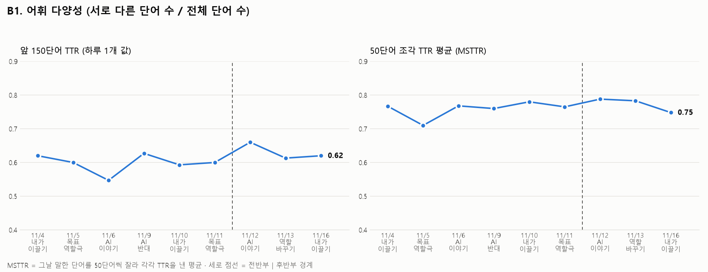
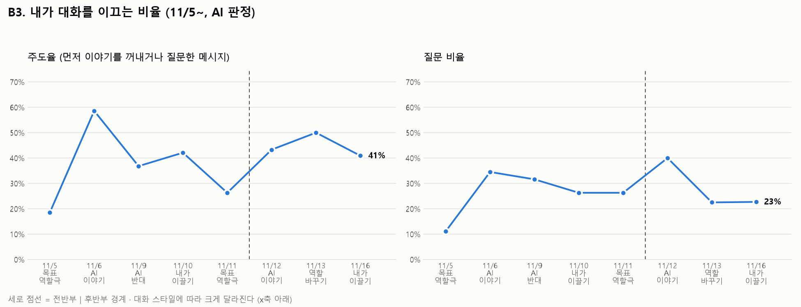

# B 분석 메모: 내 발화는 달라졌는가 (8일차, 11/16)

> 실행: `python -m analysis.prep` → `python -m analysis.metrics` → `python -m analysis.speech_change`
> 데이터: 11/4~11/16 근무일 9일, 내 메시지 248개 (전반부 11/5~11/11 113개, 후반부 11/12~11/16 114개, 기준 11/4 21개)
> 후반부 5일 중 3일치 중간값. 9일차(11/17)에 전반·후반 비교로 최종 정리.

## 한 줄 요약

**문장은 길어지지 않았고(오히려 짧아짐), 어휘 다양성은 그대로이며, 한국어는 처음부터 거의 안 썼다. 주도율은 올랐지만 대화 스타일 영향이 커서 실력 변화로 보기 어렵다.** 대신 교정 비율의 하락은 "짧게 말해서"로는 설명되지 않는다.

## B1. 문장 길이와 어휘 다양성

| | 기준 11/4 | 전반부 | 후반부 (3일) |
|---|---|---|---|
| 메시지당 평균 단어 | 7.4 | 10.2 | 8.2 |
| 중앙값 | 8 | 9 | 7.5 |
| 짧은 답 (3단어 이하) | 5% | 8% | **14%** |
| 긴 문장 (10단어 이상) | 14% | **49%** | 29% |
| MSTTR (50단어 조각 TTR 평균) | 0.77 | 0.77 | 0.78 |

- **11/4 → 전반부에는 길어졌다가, 후반부에 다시 짧아졌다.** 특히 11/16은 짧은 답 23%, 긴 문장 16%로 가장 짧았다.
- 같은 스타일 짝으로 봐도 같다: 목표 역할극 11.4 → 10.6단어, AI 이야기 9.9 → 9.9, **내가 이끌기 10.3 → 6.7** (긴 문장 63% → 16%).
- 11/16이 짧았던 이유로 보이는 것: 화상 회의 연결 문제(업무 상황극이라 "Okay", "Let's go." 같은 짧은 대답이 많음), 빨래하면서 음성으로 한 대화. 즉 **대화 주제와 상황이 길이를 크게 좌우한다.**
- **어휘 다양성은 변화 없음** (MSTTR 0.71~0.79 사이, 방향 없음). 앞 150단어 TTR도 0.55~0.66 사이에서 오르내린다.

## B2. 한국어 섞임 · 한국어로 도움 요청

- 11/4에 각 1건, **11/5부터 227개 메시지 중 0건.**
- "줄었다"가 아니라 **처음부터 거의 안 썼다 (바닥 효과).** 이 지표로는 변화를 볼 수 없다. 리포트에는 "한국어 의존은 처음부터 낮았다"로 쓴다.
- 앱에 접힌 한국어 번역 카드가 있어서 한국어로 물어볼 필요가 적었을 수도 있다 (확인 못 함).

## B3. 주도율 · 질문 비율

| | 전반부 | 후반부 |
|---|---|---|
| 주도율 | 37% | 45% |

- 겉으로는 올랐지만, **같은 스타일끼리 보면 일관되지 않다**: 목표 역할극 18% → 26% (↑), AI 이야기 59% → 43% (↓), 내가 이끌기 42% → 41% (=).
- 스타일별 주도율: AI 이야기 51%, 역할 바꾸기 50%, 내가 이끌기 41%, AI 반대 37%, 목표 역할극 22%. **스타일 차이(22~51%)가 날짜 간 변화보다 크다.** 후반부에 주도율이 높은 스타일이 많이 나와서 오른 것으로 보인다.

## 덤: 교정 비율 하락은 "짧게 말해서"인가?

후반부 교정 비율이 내려갔는데(68% → 52%) 메시지도 짧아졌다. 짧은 문장은 틀릴 곳이 적으니, 하락이 길이 때문인지 확인했다.

| 길이 | 전반부 | 후반부 |
|---|---|---|
| 1~4단어 | 53% (n=15) | 32% (n=25) |
| 5~9단어 | 65% (n=43) | 61% (n=56) |
| 10단어 이상 | **74%** (n=55) | **52%** (n=33) |

- **후반부를 전반부와 같은 길이 구성으로 맞춰도 52%** (직접 표준화). 길이 변화는 교정 비율 하락을 거의 설명하지 못한다.
- 특히 **긴 문장에서 74% → 52%**로 가장 크게 내려갔다 (95% 구간 62~84% vs 35~68%, 살짝 겹침). 긴 문장을 덜 틀리게 됐다는 신호일 수 있다. 다만 스타일·모드·AI 판정의 흔들림이 섞여 있어 9일차 AI 판정 검수와 같이 봐야 한다.

## 입력 방식 (C1 예고)

- 음성 입력 대화 2회 (11/13 일상, 11/16 표현) → **C1 비교 조건(2회) 충족.**
- 음성 메시지 18개: 평균 6.6단어, 교정 78% / 타자 209개: 9.4단어, 교정 58%.
- 단, 음성 인식 오류가 섞였다: 11/16 "laundry"를 "rendering", "rungery"로 잘못 받아 적었고, 이게 실수로 기록됐다. 내가 "no rendering, It's laundry"라고 바로잡아야 했다. → 9일차에 음성 메시지 실수 중 받아쓰기 오류를 따로 센다.

## 한계

- 날마다 대화 스타일이 하나라 날짜 효과와 스타일 효과가 섞여 있다. 깨끗한 비교는 같은 스타일 짝 3개뿐이고 각 20~40개 메시지다.
- 길이·주도율은 주제와 상황(업무 상황극, 짧은 대답이 자연스러운 장면)에 크게 좌우된다.
- 주도율·질문·교정은 AI 판정이다 (9일차 검수).
