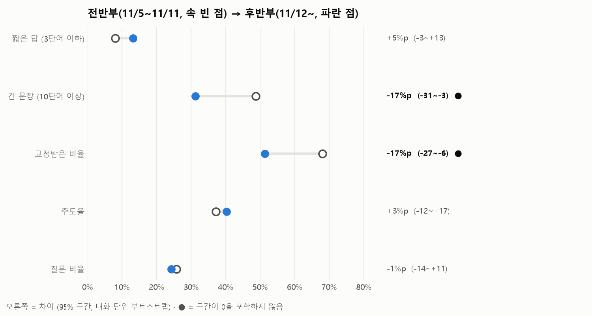

# 최종 비교 메모 (9일차, 11/17)

> 실행: `python -m analysis.prep` → `metrics` → `mistake_repeat` → `speech_change` → `final_compare`
> 데이터: 11/5~11/17 근무일 9일 (11/4는 기준일). 전반부 11/5~11/11 메시지 113개·대화 16회, 후반부 11/12~11/17 메시지 144개·대화 12회.
> 11/18(10일차)은 리포트 작성일이라, 이 값을 최종값으로 쓴다. A·B 메모(`a_memo.md`, `b_memo.md`)의 중간값은 이 메모의 값으로 바꿔 읽는다.

## 1. 전반부 vs 후반부 (대화 단위 부트스트랩 95% 구간)

| 지표 | 전반부 | 후반부 | 차이 (95% 구간) | |
|---|---|---|---|---|
| 메시지당 평균 단어 | 10.2 | 8.5 | -1.7 (-3.2~-0.3) | ● 짧아짐 |
| 짧은 답 (3단어 이하) | 8% | 13% | +5%p (-3~+13) | |
| 긴 문장 (10단어 이상) | 49% | 31% | -17%p (-31~-3) | ● 줄어듦 |
| 어휘 다양성 (MSTTR) | 0.77 | 0.78 | +0.01 (-0.02~+0.06) | |
| **교정받은 비율** | **68%** | **51%** | **-17%p (-27~-6)** | ● 줄어듦 |
| **메시지당 실수** | **0.69** | **0.50** | **-0.19 (-0.33~-0.05)** | ● 줄어듦 |
| 주도율 | 37% | 40% | +3%p (-12~+17) | |
| 질문 비율 | 26% | 24% | -1%p (-14~+11) | |

● = 구간이 0을 포함하지 않음. 같은 대화 안의 메시지끼리는 비슷하므로 메시지가 아니라 대화를 통째로 다시 뽑아 구간을 냈다 (메시지 단위보다 넓고 정직한 구간).

**같은 스타일 세 번 (목표 역할극, 11/5 → 11/11 → 11/17)**: 교정 74% → 68% → **50%**, 긴 문장 59% → 42% → 40%. 날짜와 스타일이 섞이지 않는 가장 깨끗한 비교에서도 같은 방향이다.

- **교정 하락은 길이로 설명되지 않는다** (8일차: 길이 구성을 맞춰도 같은 값).

## 2. 실수 재발 최종값 (A)

| | 다시 나옴 | 비율 (95% 구간) |
|---|---|---|
| 전반부 실수 ID 전체 | 15 / 69 | 22% (14~33%) |
| 전반부 2일 이상 | 8 / 14 | **57%** (33~79%) |
| 전반부 1일 | 7 / 55 | 13% (6~24%) |

- 고질 실수 8개가 후반부에도 나왔다: 질문 어순, 질문의 do, be동사 누락, 습관 시제, 관사 누락, 셀 수 없는 명사 앞 관사, 복수형, because 연결. 모두 문법이다.
- 후반부에 나온 ID 56개 중 41개는 처음 보는 실수다.
- **11/4를 빼도 결과가 같다**: 문법 실수가 4근무일 뒤에도 안 나온 비율 47% (11/4 포함) vs 52% (제외). 문법 외는 97% vs 100%. 결론이 11/4에 기대지 않는다.

## 3. 모드·입력 방식 (C1)

| 모드 | 메시지 | 평균 단어 | 교정 | 주도 |
|---|---|---|---|---|
| 일상 | 72 | 10.5 | 64% | 32% |
| 비즈니스 | 69 | 8.3 | 55% | 45% |
| 동사 | 71 | 9.4 | 51% | 42% |
| 표현 | 45 | 8.4 | 69% | 36% |

| 입력 | 대화 | 메시지 | 평균 단어 | 교정 | 받아쓰기 오류 뺀 교정 |
|---|---|---|---|---|---|
| 음성 | 2 | 18 | 6.6 | 78% | 67% |
| 타자 | 28 | 239 | 9.4 | 57% | 57% |

- 표현 모드가 교정이 가장 많다 (새 패턴을 일부러 써 보는 모드라 자연스럽다). 모드 배분은 6:6:6:6에 가까워 전반·후반 비교를 크게 흔들지 않는다.
- **음성은 짧고 더 많이 교정받는다.** 음성 실수 11건 중 2건은 받아쓰기 오류("laundry" → "rendering", "rungery"), 1건은 애매(복수형 s가 안 들렸을 수 있음). 빼도 67% vs 57%. 다만 음성 대화가 2회, 18개 메시지라 **방향만 보고 결론은 내지 않는다** (리포트 한계).

## 4. AI 판정 검수 (C2, 30건)

전반부 15개·후반부 15개를 무작위로 뽑아 (seed 20261117) 먼저 판정하고, 판정이 애매한 4건(#1, #6, #8, #12)은 대화를 한 본인에게 확인받았다 (4건 모두 판정 유지).

| | 전반부 | 후반부 | 전체 |
|---|---|---|---|
| AI 실수 기록 중 가짜 (고칠 필요 없는 것) | 20% (2/10) | 12% (1/8) | 17% (3/18) |
| 놓친 실수 / 메시지 | 0.00 | 0.13 | 0.07 |
| "교정 필요" 판정 일치 | 87% | 87% | 87% |
| 주도 판정 일치 | 100% | 93% | 97% |
| 질문 판정 일치 | 93% | 100% | 97% |

- **가짜 실수 예**: "May I help you?"(맞는 표현), "I've solved it"(맞는 표현), "but I like oil pasta"(맞는 문장에 better를 덧붙임). 맞는 표현을 다른 표현으로 바꿔 주는 경우가 많다.
- **놓친 실수 예**: "manager's office"(관사), "everything else okay"(be동사). 둘 다 후반부.
- **핵심**: 교정 판정 일치율이 전반·후반 모두 87%로 같다. 후반부에 AI가 실수를 더 놓치는 경향(0.13/메시지)이 조금 있지만, 이것만으로는 교정 비율 17%p 하락을 설명하기 어렵다 (메시지 100개당 놓친 실수 13건 → 교정 비율로 최대 약 13%p). **하락의 일부는 채점의 흔들림일 수 있다**는 단서를 리포트에 남긴다.

## 결론 초안 ("10일간 내 영어는 실제로 늘었나?")

1. **정확성: 늘었을 가능성이 있다.** 교정 비율과 메시지당 실수가 구간 밖으로 줄었고, 같은 스타일 세 번에서도 같은 방향이며, 길이로 설명되지 않는다. 다만 AI가 후반부에 실수를 조금 더 놓친 흔적이 있어 크기는 과대평가됐을 수 있다.
2. **고질 실수: 그대로다.** 전반부에 반복되던 실수의 57%가 후반부에도 나왔다.
3. **복잡성: 늘지 않았다.** 문장은 오히려 짧아졌고 어휘 다양성은 그대로다. 짧아진 건 대화 상황(업무 상황극, 짧은 대답)의 영향이 크다.
4. **주도성·한국어 의존: 판단할 수 없다.** 주도율은 스타일 영향이 크고, 한국어는 처음부터 0이었다.

## 한계

- 사용자 1명, 9일, 메시지 257개. 날마다 스타일이 하나라 날짜와 스타일이 섞인다 (같은 스타일 짝으로 일부 보완).
- 정확성 지표는 AI 판정이다. 검수 30건은 한 번 판정한 뒤 애매한 4건만 본인에게 확인받았다 (두 번째 판정자 없음).
- 음성 입력은 2회뿐이다. 유창성(말하는 속도, 머뭇거림)은 측정하지 못했다.
