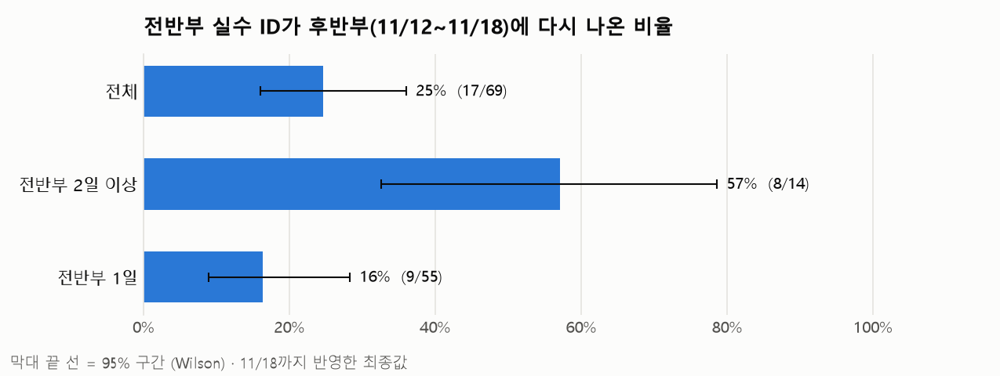

# 최종 비교 메모 (10일차, 11/18 최종)

> 실행: `python -m analysis.prep` → `metrics` → `mistake_repeat` → `speech_change` → `final_compare`
> 데이터: 11/5~11/18 근무일 10일 (11/4는 기준일). 전반부 11/5~11/11 메시지 113개·대화 16회, 후반부 11/12~11/18 메시지 167개·대화 15회.
> 9일차(11/17)에 낸 값을 11/18 마지막 대화까지 넣어 다시 계산했다. A·B 메모(`a_memo.md`, `b_memo.md`)의 중간값은 이 메모의 값으로 바꿔 읽는다. 9일차 값과 달라진 곳은 "(9일차 …)"로 적었다.

## 1. 전반부 vs 후반부 (대화 단위 부트스트랩 95% 구간)

| 지표 | 전반부 | 후반부 | 차이 (95% 구간) | |
|---|---|---|---|---|
| 메시지당 평균 단어 | 10.2 | 8.7 | -1.6 (-2.8~-0.1) | ● 짧아짐 |
| 짧은 답 (3단어 이하) | 8% | 11% | +3%p (-4~+11) | |
| 긴 문장 (10단어 이상) | 49% | 33% | -16%p (-28~-2) | ● 줄어듦 |
| 어휘 다양성 (MSTTR) | 0.77 | 0.78 | +0.01 (-0.01~+0.06) | |
| **교정받은 비율** | **68%** | **53%** | **-15%p (-25~-5)** | ● 줄어듦 (9일차 -17%p) |
| **메시지당 실수** | **0.69** | **0.51** | **-0.18 (-0.32~-0.05)** | ● 줄어듦 |
| 주도율 | 37% | 41% | +4%p (-11~+18) | |
| 질문 비율 | 26% | 28% | +2%p (-10~+15) | |

● = 구간이 0을 포함하지 않음. 같은 대화 안의 메시지끼리는 비슷하므로 메시지가 아니라 대화를 통째로 다시 뽑아 구간을 냈다.

**같은 스타일 반복 비교** (날짜와 스타일이 섞이지 않는 비교)

| 스타일 | 날짜 | 메시지 | 교정 | 긴 문장 |
|---|---|---|---|---|
| 목표 역할극 | 11/5 → 11/11 → 11/17 | 27 → 19 → 30 | 74% → 68% → **50%** | 59% → 42% → 40% |
| AI 이야기 | 11/6 → 11/12 → 11/18 | 29 → 30 → 23 | 66% → 50% → **61%** | 41% → 37% → 44% |
| 내가 이끌기 | 11/10 → 11/16 | 19 → 44 | 53% → 46% | 63% → 16% |

- 세 짝 모두 첫 회보다 마지막 회의 교정 비율이 낮다. 다만 AI 이야기는 11/18에 다시 올라가 **꾸준히 줄어드는 모양은 아니다.** 하루 메시지 20~40개라 날마다 ±10%p 정도는 흔들린다.
- **교정 하락은 길이로 설명되지 않는다**: 후반부를 전반부 길이 구성(1-4 / 5-9 / 10+단어)으로 맞춰도 54%.

## 2. 실수 재발 최종값 (A)

| | 다시 나옴 | 비율 (95% 구간) |
|---|---|---|
| 전반부 실수 ID 전체 | 17 / 69 | 25% (16~36%) |
| 전반부 2일 이상 | 8 / 14 | **57%** (33~79%) |
| 전반부 1일 | 9 / 55 | 16% (9~28%) |

- 고질 실수 8개는 9일차와 같다: 질문 어순, 질문의 do, be동사 누락, 습관 시제, 관사 누락, 셀 수 없는 명사 앞 관사, 복수형, because 연결. 모두 문법이다.
- 11/18에 1일짜리 2개가 더 나왔다: `how_can_i_help` ("What can I help you?"), `my_possessive` ("without phone").
- 후반부에 나온 ID 66개 중 49개는 처음 보는 실수다.
- 유형별로 2일 이상 나온 ID 비율: 문법 41% (20/49), 어휘 15% (2/13), 표현 5% (2/41), 철자 0% (0/15).
- **11/4를 빼도 결과가 같다**: 문법 실수가 4근무일 뒤에도 안 나온 비율 52% (11/4 포함) vs 57% (제외). 문법 외는 97% vs 100%.

## 3. 모드·입력 방식 (C1)

| 모드 | 대화 | 메시지 | 평균 단어 | 교정 | 주도 |
|---|---|---|---|---|---|
| 일상 | 8 | 79 | 10.5 | 63% | 32% |
| 비즈니스 | 8 | 74 | 8.4 | 57% | 43% |
| 동사 | 7 | 71 | 9.4 | 51% | 42% |
| 표현 | 7 | 56 | 8.7 | 66% | 43% |

| 입력 | 대화 | 메시지 | 평균 단어 | 교정 | 받아쓰기 오류 뺀 교정 |
|---|---|---|---|---|---|
| 음성 | 2 | 18 | 6.6 | 78% | 67% |
| 타자 | 31 | 262 | 9.5 | 58% | 58% |

- 표현 모드가 교정이 가장 많다 (새 패턴을 일부러 써 보는 모드라 자연스럽다). 모드 배분이 8:8:7:7로 고르게 맞춰져 전반·후반 비교를 크게 흔들지 않는다.
- 음성은 짧고 더 많이 교정받는다. 받아쓰기 오류 2건을 빼도 67% vs 58%. 다만 음성 대화가 2회, 18개 메시지라 **방향만 보고 결론은 내지 않는다**.

## 4. AI 판정 검수 (C2, 30건)

9일차에 뽑은 30건 그대로다 (11/18 데이터는 표본에 없음). 전반부 15개·후반부 15개를 무작위로 뽑아 (seed 20261117) 먼저 판정하고, 애매한 4건(#1, #6, #8, #12)은 대화를 한 본인에게 확인받았다 (4건 모두 판정 유지).

| | 전반부 | 후반부 | 전체 |
|---|---|---|---|
| AI 실수 기록 중 가짜 (고칠 필요 없는 것) | 20% (2/10) | 12% (1/8) | 17% (3/18) |
| 놓친 실수 / 메시지 | 0.00 | 0.13 | 0.07 |
| "교정 필요" 판정 일치 | 87% | 87% | 87% |
| 주도 판정 일치 | 100% | 93% | 97% |
| 질문 판정 일치 | 93% | 100% | 97% |

- **가짜 실수 예**: "May I help you?", "I've solved it" (둘 다 맞는 표현). 11/18에도 "come back home" → "get back home"처럼 맞는 표현을 바꿔 준 기록이 있다.
- **놓친 실수 예**: "manager's office" (관사), "everything else okay" (be동사). 둘 다 후반부.
- 교정 판정 일치율이 전반·후반 모두 87%로 같다. 후반부에 AI가 실수를 조금 더 놓쳤지만 (0.13/메시지), 이것만으로 교정 비율 15%p 하락을 다 설명하기는 어렵다. **하락의 일부는 채점의 흔들림일 수 있다.**

## 결론 ("10일간 내 영어는 실제로 늘었나?")

1. **정확성: 늘었을 가능성이 있다.** 교정 비율 68% → 53%, 메시지당 실수 0.69 → 0.51이 구간 밖으로 줄었고, 길이로 설명되지 않으며, 같은 스타일 세 짝 모두 첫 회보다 마지막 회가 낮다. 다만 날마다 흔들림이 크고 (AI 이야기 11/18 반등), AI가 후반부에 실수를 조금 더 놓친 흔적이 있어 크기는 과대평가됐을 수 있다.
2. **고질 실수: 그대로다.** 전반부에 반복되던 실수의 57% (8/14)가 후반부에도 나왔다. 모두 문법 규칙이다.
3. **복잡성: 늘지 않았다.** 문장은 오히려 짧아졌고 (긴 문장 49% → 33%) 어휘 다양성은 그대로다. 짧아진 건 대화 상황(업무 상황극, 짧은 대답)의 영향이 크다.
4. **주도성·한국어 의존: 판단할 수 없다.** 주도율은 스타일 영향이 크고, 한국어는 처음부터 0이었다.

## 한계

- 사용자 1명, 10일, 메시지 280개. 날마다 스타일이 하나라 날짜와 스타일이 섞인다 (같은 스타일 짝으로 일부 보완).
- 정확성 지표는 AI 판정이다. 검수 30건은 한 번 판정한 뒤 애매한 4건만 본인에게 확인받았다 (두 번째 판정자 없음).
- 음성 입력은 2회뿐이다. 유창성(말하는 속도, 머뭇거림)은 측정하지 못했다.
