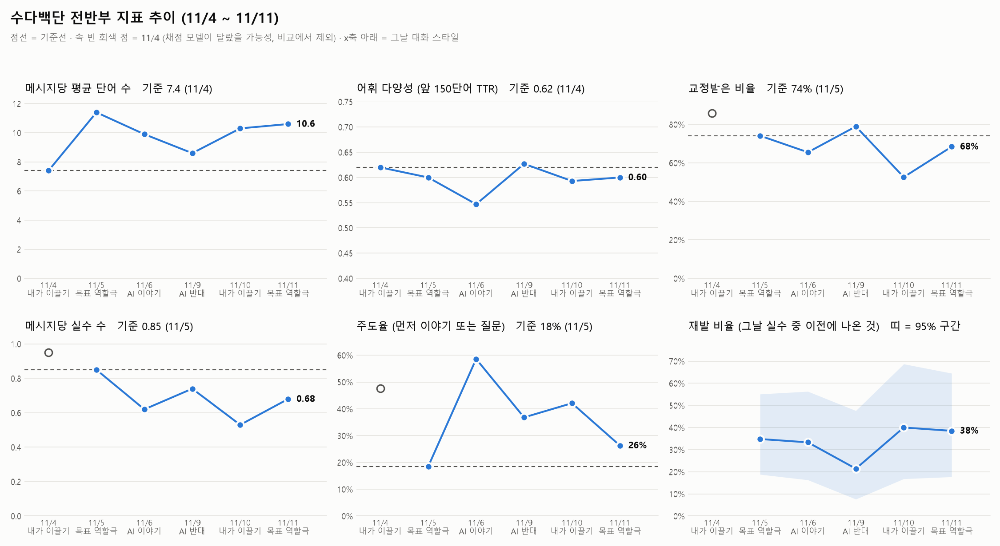

# 중간 점검 메모 (5일차, 2026-11-11)

전반부(11/4 기준일 + 근무일 11/5~11/11, 대화 19회) 데이터로 지표가 제대로 나오는지 점검하고, 후반부 분석 방법을 조정한다.
계산: `python -m analysis.prep` → `python -m analysis.metrics` → `python -m analysis.interim`

## 1. 한눈에 보기

| 지표 | 기준선 | 11/11 | 판단 |
|---|---|---|---|
| 메시지당 평균 단어 수 | 7.4 (11/4) | 10.6 | 11/5부터 매일 기준선 위 (8.6~11.4). **B1의 가장 뚜렷한 변화** |
| 어휘 다양성 (TTR) | 0.62 (11/4) | 0.60 | 0.55~0.63에서 오르내림. 변화 없음 |
| 교정받은 비율 | 74% (11/5) | 68% | 53~79%로 출렁임. 아래 2절: 대부분 모드 구성 효과 |
| 메시지당 실수 수 | 0.85 (11/5) | 0.68 | 기준선 아래 유지 (0.53~0.74) |
| 주도율 | 18% (11/5) | 26% | 대화 스타일 영향이 큼 (11/6 AI 이야기 59%) |
| 그날 재발 비율 | 없음 | 38% | 하루 표본이 작아 95% 구간이 ±20~25%p. 아래 3절 |

## 2. 모드·대화 스타일 효과 분리

**모드별 (11/5~11/11, AI 판정 지표)**

| 모드 | 대화 | 메시지 | 평균 단어 | 교정 비율 | 메시지당 실수 | 주도율 |
|---|---|---|---|---|---|---|
| 일상 | 4 | 43 | 10.9 | 70% | 0.70 | 35% |
| 비즈니스 | 4 | 27 | 9.6 | 70% | 0.67 | 41% |
| 동사 | 4 | 25 | 10.2 | **56%** | 0.60 | 40% |
| 표현 | 3 | 18 | 9.6 | 78% | 0.83 | 33% |

- **동사 모드는 교정을 덜 받는다** (56% vs 다른 모드 70~78%). 11/10 교정 비율 53%(최저)는 그날 메시지 19개 중 12개가 동사 모드였던 영향이 크다.
- 다만 11/10 표현 모드는 43%로, 이전 두 번(100%, 100%)보다 크게 낮다. 모드만으로는 설명되지 않는다 (메시지 5~7개라 판단 보류).

**대화 스타일은 날짜와 완전히 겹친다.** 앱이 스타일을 하루에 하나로 고정하므로, 스타일 효과와 "날이 지나서 생긴 변화"를 나눌 수 없다. 유일하게 같은 스타일이 두 번 나온 날짜 쌍이 **11/5와 11/11 (둘 다 목표 역할극)**이라 이 둘을 깨끗한 비교로 쓴다.

**같은 스타일 비교: 11/5 vs 11/11 (모드 구성도 일상·비즈니스·동사로 맞춤)**

| 지표 | 11/5 | 11/11 | 변화 |
|---|---|---|---|
| 메시지 수 | 21 | 19 | |
| 평균 단어 수 | 12.0 | 10.6 | −1.4 |
| 교정받은 비율 | 66.7% | 68.4% | **변화 없음** |
| 메시지당 실수 | 0.81 | 0.68 | −0.13 |
| 질문 비율 | 14% | 26% | +12%p |

→ 조건을 맞추면 **교정 비율은 그대로**다. 날짜별 그래프에서 보인 출렁임은 대부분 모드·스타일 차이로 보인다. 실수 수 감소와 질문 증가는 방향은 좋지만 메시지 20개 안팎이라 우연과 구분하기 어렵다.

## 3. 잘 안 나오는 지표와 조정

| 지표 | 문제 | 조정 |
|---|---|---|
| **그날 재발 비율** | 하루 유효 실수 10~23건이라 95% 구간이 넓다 (11/10: 40%, 구간 17~69%). 날짜별 오르내림은 의미가 없다 | 날짜별 추이는 참고만 한다. A1 핵심 지표를 **"전반부에 나온 실수 ID가 후반부(11/12~11/18)에 다시 나오는 비율"**로 바꾼다. 전반부 ID 69개가 분모 |
| **누적 재발률** | 15% (11/5) → 20% (11/11). 날이 쌓일수록 다시 나올 기회가 많아져 저절로 오른다 | 개선 지표로 쓰지 않고, 반복되는 실수 목록을 고르는 데만 쓴다 |
| **어휘 다양성 (TTR)** | 앞 150단어로 계산하는데 하루 말한 양이 155~308단어. 11/4(155), 11/9(163)는 겨우 넘었다 | 150단어 유지. 모자라는 날은 빈칸으로 두고(자동), 하루 대화 20분 이상을 지킨다 |
| **3분 미만 대화** (2건: 108초, 8초) | 대화 수와 모드 배분을 부풀린다 | **대화 단위 집계에서 제외**, 메시지는 유지 (합쳐서 메시지 2개라 영향 없음) |
| **말하지 않은 실수 기록** (3건) | 3건 모두 직접 확인: 다른 메시지의 실수를 잘못 붙였거나 하지 않은 말 | **분석에서 제외 확정** (지금처럼 `valid = False`) |
| **입력 방식 비교 (C1)** | 음성 입력 0건 (5일째) | 11/16까지 음성 대화가 2회 미만이면 C1은 리포트 "한계"로 돌린다 |

## 4. 지금까지 보이는 반복 실수 (2일 이상 나온 ID 14개 중 3일 이상인 것)

| 실수 ID | 나온 날 | 내용 |
|---|---|---|
| `question_word_order` | 11/4 · 11/6 · 11/9 · 11/10 | 질문 어순 ("what do you like a korean TV show") |
| `present_for_habit` | 11/4 · 11/6 · 11/9 | 습관을 과거형으로 ("i usually watched") |
| `be_verb_missing` | 11/4 · 11/6 · 11/10 | be동사 누락 ("i good", "what your favorite member") |

나머지 11개는 2일씩: 불규칙 과거형, 과거형 누락, 질문의 do, 이유 연결(because), 미래 will, 관사, 셀 수 없는 명사, if 조건문, 복수형, 수면·마감 표현 등.

## 5. 후반부 계획 조정

- 모드 배분 (3분 이상, 11/5~): 일상 4 · 비즈니스 4 · 동사 4 · **표현 3** → 표현 모드 보충.
- 후반부에 목표 역할극 외 스타일이 다시 나오면, 그 스타일의 전반부 날짜와 짝지어 비교한다 (스타일은 앱이 정해서 고를 수 없음).
- 7일차 A 분석은 3절의 "전반부 ID의 후반부 재등장 비율"로, 8일차 B 분석은 평균 단어 수를 중심으로 같은 스타일 짝 비교를 붙인다.
